<!-- ═══════════════════════  HEADER  ═══════════════════════ -->


<p align="center">
  <a href="https://git.io/typing-svg">
    
  </a>
</p>

<p align="center">
  
  <a href="https://linkedin.com/in/darshannair74"></a>
  <a href="https://github.com/dash074?tab=followers"></a>
</p>

---

<!-- ═══════════════════════  ABOUT  ═══════════════════════ -->


### `> whoami`

```python
class Dash:
    studying   = "B.Tech CSE (AI & ML) @ PCCoE, Pune"
    building   = ["custom multirotors", "flight controllers", "agentic AI apps"]
    role       = "Autonomous Systems @ Team Maverick India"
    interests  = ["UAVs", "computer vision", "embedded", "robotics"]
    motto      = "If it doesn't fly, tune it again."

    def currently(self):
        return "Teaching drones to navigate without GPS 🛰️❌"
```

<br clear="right"/>

---

<!-- ═══════════════════════  STACK  ═══════════════════════ -->
### ⚙️ Arsenal

<p align="center">
  <b>Code</b><br/>
  
</p>
<p align="center">
  <b>AI / Vision</b><br/>
  
  
</p>
<p align="center">
  <b>Hardware & Robotics</b><br/>
  
  
  
</p>
<p align="center">
  <b>Design & Tools</b><br/>
  
</p>

---

<!-- ═══════════════════════  STATS  ═══════════════════════ -->
### 📡 Telemetry

<p align="center">
  
  
</p>
<p align="center">
  
</p>

<p align="center">
  
</p>

---

<p align="center">
  
</p>


